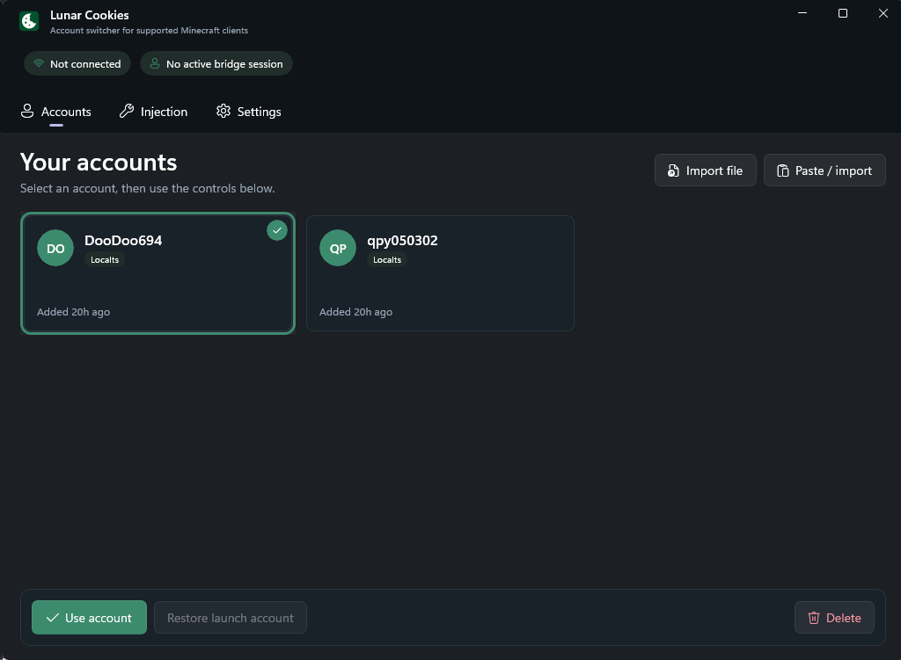

# Lunar Cookie 账号切换器


[English](README.md) | 简体中文

一个便携式 WinUI 3 账号切换器，适用于多种 Minecraft Java 客户端。支持
Localts 刷新令牌（`M.C…`）以及 Netscape 或 cookie 请求头格式的 Microsoft
会话 cookie。

## 展示

[](https://youtu.be/t8smWCKkc6M)

观看 [Lunar Cookies 展示视频](https://youtu.be/t8smWCKkc6M)。

## 客户端兼容性

注入的辅助模块通过运行时结构校验来定位 Minecraft 单例以及会话/用户对象，
已知名称仅用作快速路径。

- Minecraft 1.8.9：Forge 与 Lunar Client 旧版会话结构
- Minecraft 1.21.x：Fabric/intermediary 与 Lunar + Fabric 会话结构
- Minecraft 26.1 与 26.2：官方命名、Fabric 与 Lunar 现代用户结构

覆盖了 1.8.9 的四字符串构造函数、1.21 的五参数 Yarn 会话构造函数，以及官方
26.1/26.2 的 `User(String, UUID, String, Optional, Optional)` ABI。未知或不
明确的布局会安全失败；桥接不会向猜测的字段写入数据。

## 界面

- **Accounts（账号）** 以三列卡片网格显示已保存的账号。选择一张卡片，然后
  使用底部工具栏切换账号、恢复 Lunar 启动时使用的账号，或删除已保存的凭据。
- **Cosmetics（外观）** 解锁 Lunar Client 衣柜中的全部披风、翅膀、表情、徽章
  和饰件。会重新修补内存中的 RPC 桩，并管理本地装扮持久化。
- **Servers（服务器）** 列出已保存的 Minecraft 服务器以及一个直连输入框。
  加入服务器使用 Minecraft 自带的连接流程，因此无需 Lunar 的 Microsoft
  账号菜单。已保存的服务器可以 ping 获取延迟、玩家数量和 MOTD。
- 账号文件可以拖放到窗口的任意位置。多个文件会按顺序依次认证，请求之间保持
  间隔。
- 临时的 Microsoft/Xbox/Minecraft 故障会通过退避重试，并支持 `Retry-After`。
  批量结果会指出每个失败的文件名和安全 HTTP 状态码，不会记录 cookie、令牌或
  响应正文。
- **Injection（注入）** 包含桥接连接控制、当前 Lunar 会话详情、进程检测和
  诊断日志。
- **Settings（设置）** 控制最小化到托盘的行为、是否在注入或切换时自动解锁
  外观（默认关闭）、切换器是否在检测到的 Minecraft 进程关闭后自动退出，以及
  是否尝试填充 Lunar Client 的本地账号管理器（默认关闭）。
- 切换账号会在需要时自动注入或重连桥接。当 Lunar 处于世界内或已连接到服务器
  时，切换和恢复操作会被阻止。
- 界面跟随 Windows 浅色或深色主题，并在各标签页之间保持所选账号与桥接状态的
  同步。

## 构建

前置条件：

- .NET 8 SDK
- 首次还原 Microsoft Windows App SDK 2.3.1 时需要互联网访问
- 用于 `switcher.dll` 的 MinGW-w64 `g++`
- 用于注入式会话辅助模块的 JDK 8+（`javac`）

构建原生桥接，并发布免安装、自包含的 x64 WinUI 3 应用：

```bat
build_dll.bat
build_exe.bat
```

便携版输出位于 `publish\`。请将 `LunarCookies.exe` 和 `switcher.dll` 一起分发。
WinUI 和 .NET 运行时依赖已捆绑进可执行文件中，并在启动时自动解压，因此无需
单独安装 Windows App SDK 运行时。

构建 Debug 版本：

```bat
build_dll.bat
dotnet run --project LunarCookies -c Debug
```

运行解析器冒烟检查：

```bat
LunarCookies\bin\Debug\net8.0-windows10.0.19041.0\win-x64\LunarCookies.exe --smoke-parser
```

运行合成解析器回归测试套件：

```bat
dotnet run --project LunarCookies.Tests -c Release
```

## 使用方法

1. 启动受支持的 Minecraft 客户端并停留在主菜单。
2. 运行 `LunarCookies.exe`。
3. 在 **Accounts** 中导入 Localts 令牌或 cookie 文件。
4. 选择一个账号并点击 **Use account**。桥接会在需要时自动连接。
5. 打开 **Servers** 并加入一个主机，或者如果那里已登录 Microsoft 账号，直接
   使用 Lunar 自带的菜单。
6. 切换或恢复账号前，先断开连接返回主菜单。

**Restore launch account** 会恢复 Lunar 启动时使用的会话；它并非真正的登出
状态。**Delete** 仅删除已保存的凭据，不会更改 Lunar 中当前活动的会话。

支持 Netscape 格式的 cookie 导出文件，包括以账号用户名为文件名的文件。cookie
文件名不影响解析。cookie 认证会跟随 Microsoft/Xbox 重定向，同时保留域作用域
的 cookie 和响应 cookie 更新。

## 离线（Cracked）账号

**Add cracked** 仅凭用户名即可创建离线模式档案——无需 Microsoft 账号、cookie
或令牌：

1. 在 Accounts 标签页点击 **Add cracked**，输入 Minecraft 用户名（3–16 个
   字母、数字和下划线字符；无效名称会被拒绝）。
2. 像其他账号一样选择卡片并点击 **Use account**。桥接会直接替换会话，不触及
   Microsoft 认证。
3. 离线档案会在卡片上标记为 **Cracked**，导入时按 UUID 匹配，因此同名账号可
   与正版账号共存。

UUID 按 Minecraft 的标准离线约定生成——对 `"OfflinePlayer:" + name` 计算 v3
（MD5）UUID——因此采用相同方式计算 UUID 的离线服务器和插件能够一致地识别该
账号。访问令牌是约定俗成的 `"0"` 占位符；离线服务器从不验证它。

限制：

- 离线会话仅在运行于 `online-mode=false` 的服务器上有效。任何在线服务器或
  Mojang 会话服务都会拒绝它们。
- 如果启用了 **Populate Lunar account manager**，离线条目会被写入 Lunar 的
  `accounts.json`，但 Lunar 期望的是 Microsoft 凭据，可能会在重启时拒绝或
  覆盖它们。
- **Restore launch account** 始终恢复 Lunar 启动时使用的会话，绝不会是离线
  会话。

默认情况下，最小化窗口会将 Lunar Cookies 移至通知区域；双击其托盘图标即可
恢复。应用也会在先前检测到的 Minecraft 进程关闭后退出。这两种行为都可以在
**Settings** 中禁用。

账号与早期版本保持兼容，存储在 `%AppData%\LunarCookies\accounts.json`。令牌
当前以明文存储，请将该文件视为机密。

偏好设置存储在 `%AppData%\LunarCookies\settings.json`。已保存的服务器存储在
`%AppData%\LunarCookies\servers.json`。

如果启用了 **Populate Lunar account manager**，Lunar Cookies 会使用 Lunar
自身的账号文件字段，将当前 Microsoft 会话写入
`%USERPROFILE%\.lunarclient\settings\game\accounts.json`，并在存在 MSA 刷新
令牌时一并写入。Lunar 在进程启动时读取该文件，因此写入后必须完全关闭并重新
启动客户端。没有刷新令牌的纯 cookie 账号仍可能被忽略。该设置默认关闭。

- 桥接日志：`%TEMP%\lunar_cookies_bridge.log`
- 界面崩溃日志：`%TEMP%\lunar_cookies_ui_crash.log`
- TCP 控制端口：`127.0.0.1:25591`

TCP 握手包含协议版本和目标 PID。这可以防止另一个 Minecraft 实例中已在运行的
桥接接收命令。同一时间只能有一个桥接占用该固定端口；切换账号前请关闭其他已
注入的实例。

本地安全模型和私有漏洞报告说明记录在 [SECURITY.md](SECURITY.md) 中。

## 外观解锁器

Lunar Cookies 包含一个针对 Lunar Client 的内存内外观解锁器：

- **衣柜访问**：直接在 Lunar Client 原生衣柜界面中解锁全部披风、翅膀、表情、
  徽章和外观饰件。
- **内存内修补**：通过原生 JVMTI 桥接在 JVM 内存中动态重定义 Lunar Client 的
  gRPC 桩（`CosmeticService`、`BadgeService`、`EmoteService`、`SprayService`），
  不修改磁盘上的游戏文件。
- **本地持久化**：装扮、已装备的表情、喷漆和徽章会本地保存到
  `%APPDATA%\.minecraft\prometheus\saved\`，并在后续游戏启动时恢复。
- **自动解锁**：可以从 **Cosmetics** 标签页手动触发，也可以通过 **Settings**
  设置为桥接连接或切换账号时自动解锁（默认关闭）。

## 兼容性设计

- 界面只选择被明确识别的 Minecraft/Lunar Java 窗口；绝不会回退到任意 Java
  应用程序。
- 加载器使用 `LoadLibraryW`，验证 JVM/注入器架构，检查远程写入是否完整，并且
  在超时的加载器线程可能仍在使用远程路径内存时绝不释放该内存。
- DLL 会以基于内容哈希的文件名暂存，避免升级时出现过期或被锁定的二进制文件。
- 辅助模块在每次写入前验证当前会话值和构造函数，在有调度器可用时将变更调度到
  Minecraft 线程，在该线程上重新检查世界内防护，并验证写入结果。
- 命令有大小限制，诊断日志仅记录操作名称；访问令牌不会写入桥接日志。

构造函数 ABI 冒烟测试覆盖位于
`JavaHelper/SessionSwitcherCompatibilityTest.java`。

## 致谢

- 基础的 cookie 解析和认证流程源自 The_Fireplace 与 VidTu 的
  [In-Game Account Switcher](https://github.com/VidTu/In-Game-Account-Switcher)。
- 外观解锁逻辑、RPC protobuf 响应模式以及本地装扮持久化架构改编自
  [prometheusreengineering](https://github.com/prometheusreengineering) 的
  [Prometheus](https://github.com/prometheusreengineering/minecraft-lunar) 补丁。

## 许可证

Lunar Cookies 采用 GNU 通用公共许可证第 3 版或更高版本授权。参见 `LICENSE`
和 `NOTICE.md`。
